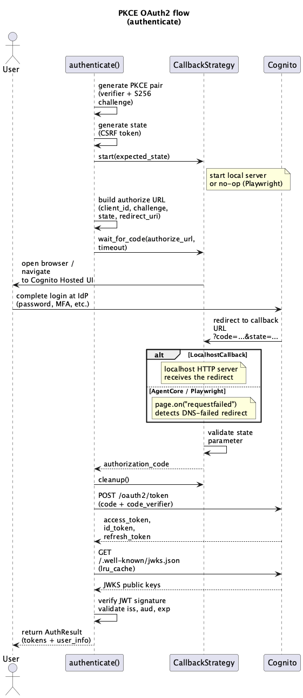
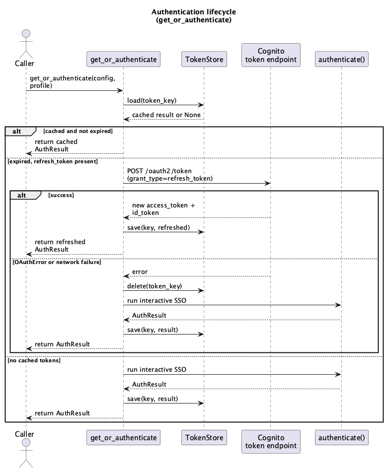
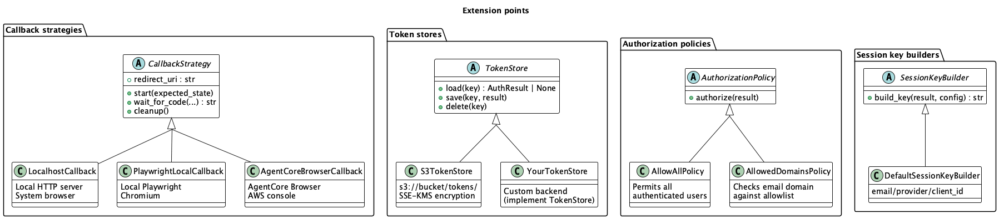

# NovaAct Auth

Inbound authentication and authorization for Amazon Nova Act agents - verifying who the user is and whether they are allowed to run the agent.

Currently provides Cognito PKCE OAuth2 SSO as the authentication mechanism, handling the login flow (PKCE challenge, callback interception, token exchange, and token refresh) and returning Cognito JWT tokens (`AuthResult`) with user identity claims. After authentication, an extensible authorization layer (`AuthorizationPolicy`) decides whether the user is permitted to run the agent. Includes pluggable token persistence (`TokenStore`) with an S3 backend. Browser session persistence (cookies, localStorage) is handled separately by the NovaAct SDK's `BrowserSessionProvider`.

> **Note:** This library is experimental and in preview. APIs may change without notice.

> **Note:** This library works with any OIDC-compliant identity provider federated through Cognito (Okta, Microsoft Entra ID, Google Workspace, Auth0, Ping Identity, OneLogin, Keycloak, AWS IAM Identity Center, or any custom OIDC provider). The library talks to Cognito, not to the IdP directly - Cognito handles the federation. The setup guide documents Okta and Entra ID as examples, but the same pattern applies to any OIDC IdP. Cognito also supports SAML 2.0 IdPs, but this library has only been tested with OIDC.

## Scope and non-goals

This library handles **interactive, user-facing authentication** - a human proves their identity via browser-based SSO before the agent runs. **It does not cover:**

- **Service-to-agent authentication** - validating programmatic API calls to an agent deployed as a service. For agents deployed on [AgentCore Runtime](https://docs.aws.amazon.com/bedrock-agentcore/latest/devguide/runtime.html), use [AgentCore Identity inbound JWT authorization](https://docs.aws.amazon.com/bedrock-agentcore/latest/devguide/inbound-jwt-authorizer.html) (see [AgentCore Identity](#agentcore-identity)). For self-hosted agents, see [Service-to-agent without AgentCore](#service-to-agent-without-agentcore).
- **Agent-to-service credential provisioning** - obtaining credentials for agents to call downstream APIs or AWS services. See [AgentCore Identity outbound](https://docs.aws.amazon.com/bedrock-agentcore/latest/devguide/identity-outbound-credential-provider.html).
- **Agent-to-agent authentication** - agents calling other agents. See [AgentCore Gateway](https://docs.aws.amazon.com/bedrock-agentcore/latest/devguide/gateway.html).

### Where this library fits

| Authentication pattern | Solution | User interaction |
|---|---|---|
| Human triggers agent (interactive) | **This library** (Cognito PKCE SSO) | Browser login |
| Service calls agent on AgentCore | [AgentCore Identity inbound](https://docs.aws.amazon.com/bedrock-agentcore/latest/devguide/inbound-jwt-authorizer.html) | None (JWT validation) |
| Service calls self-hosted agent | [Amazon API Gateway + Cognito authorizer](https://docs.aws.amazon.com/apigateway/latest/developerguide/apigateway-integrate-with-cognito.html) | None (JWT validation) |
| Agent calls external API | [AgentCore Identity outbound](https://docs.aws.amazon.com/bedrock-agentcore/latest/devguide/identity-outbound-credential-provider.html) | None (credential vending) |
| Agent accesses web UI | NovaAct SDK (`BrowserSessionProvider`) | First-run login, then cookies |

## How SSO works in this library

This library implements the [OAuth 2.0 authorization code flow](https://datatracker.ietf.org/doc/html/rfc6749) with [PKCE](https://datatracker.ietf.org/doc/html/rfc7636) (Proof Key for Code Exchange) via [Amazon Cognito](https://docs.aws.amazon.com/cognito/latest/developerguide/using-pkce-in-authorization-code.html).

### Plain-language walkthrough

Think of it like getting into a building with a security desk:

1. **You walk up to the building** (your agent starts) - the library says "you need a badge to enter."
2. **The building sends you to the badge office** (Cognito) - but first, the library creates a secret handshake (PKCE) that only it knows.
3. **The badge office says "I don't know you, go to your company's front desk"** (Cognito redirects to your identity provider) - this is where you prove who you are (password, MFA, whatever your company requires). The library has no control here.
4. **Your company stamps a slip of paper** (authorization code) and sends you back to the building with it.
5. **The library catches you at the door** (callback - localhost server, Playwright, or AgentCore intercepts the redirect), takes the slip of paper, and goes back to the badge office saying "here's the slip AND the secret handshake from step 2."
6. **The badge office verifies both match** and hands back your actual badge (JWT tokens - access token, ID token, refresh token). The PKCE secret handshake proves it's the same library that started the flow, not someone who stole the slip.
7. **The library reads your badge** (decodes the ID token) to learn who you are (email, groups, etc.) and saves it for next time (token store).

Next time you show up, the library checks if your badge is still valid. If it expired, it quietly gets you a new one (refresh token) without sending you back to the badge office.

### Technical details

The library uses the OAuth 2.0 authorization code flow with PKCE. Here is what happens end to end:

1. **Library generates a PKCE challenge** - a random code verifier and its SHA-256 hash (code challenge). This proves that the same client that started the flow is the one exchanging the code.
2. **Library builds a Cognito authorize URL** - includes the client ID, requested scopes, PKCE code challenge, a random state parameter (CSRF protection), and the callback URL.
3. **Browser opens the Cognito Hosted UI** - the user sees the login page. If an IdP is configured, Cognito redirects to the IdP's login page.
4. **User completes login** - the user enters their credentials at the IdP. The IdP authenticates the user and redirects back to Cognito.
5. **Cognito issues an authorization code** - Cognito redirects the browser to the callback URL with the authorization code and state parameter in the query string: `https://.../callback?code=abc123&state=xyz`
6. **Library captures the authorization code** - how this happens depends on the callback strategy (see below).
7. **Library exchanges the code for tokens** - sends the authorization code and PKCE code verifier to the Cognito token endpoint. Cognito validates both and returns JWT tokens (access token, ID token, refresh token).
8. **Library verifies the ID token** - fetches Cognito's public keys (JWKS) and verifies the ID token signature, issuer, audience, and expiration.
9. **Library returns `AuthResult`** - contains the three tokens, expiration timestamp, and decoded user identity claims (email, sub, groups, etc.).



### How the callback URL works

The authorization code arrives via a browser redirect to the callback URL. Each strategy handles this differently:

**`LocalhostCallback`** runs a local HTTP server on `http://localhost:8976/callback`. Cognito redirects the browser there, the server receives the request, extracts the code, and returns a success page. HTTP (not HTTPS) is used because the loopback interface is explicitly exempt from the TLS requirement for native app OAuth callbacks per [RFC 8252 §8.3](https://datatracker.ietf.org/doc/html/rfc8252#section-8.3).

**`AgentCoreBrowserCallback`** and **`PlaywrightLocalCallback`** use a non-resolvable URL: `https://auth.callback.internal/callback`. There is no real server at that address. When Cognito redirects the browser there, DNS resolution fails and the page would normally show "This site can't be reached". However, Playwright detects the redirect and captures the full URL with the authorization code in the query string. The library intercepts this redirect, extracts the code, and replaces the error page with a friendly "Identity verified" message.

No real server is needed for these strategies - the callback URL is just a vehicle to carry the authorization code back from Cognito. The URL only needs to be registered in the Cognito App Client's allowed callback URLs.

## Installation

This package is not published to PyPI. If you want to test it out, please clone the repository and install locally:

```bash
git clone https://github.com/<org>/nova-act-auth.git
cd nova-act-auth
pip install .
```

## Prerequisites

- Python 3.11+
- A Cognito User Pool with a public App Client (no client secret) and PKCE enabled
- Playwright browsers installed: `playwright install chromium`
- AWS credentials (only needed for `AgentCoreBrowserCallback` and `S3TokenStore`)

## Quick start

```python
from nova_act_auth import AuthConfig, AllowedDomainsPolicy, get_or_authenticate

config = AuthConfig.from_env()
result = get_or_authenticate(config)

policy = AllowedDomainsPolicy(["company.com"])
policy.authorize(result)  # raises AuthorizationError if denied

print(f"Authenticated as {result.user_info.get('email')}")
```

`get_or_authenticate` handles the full authentication lifecycle: loads cached tokens, refreshes if expired, falls back to interactive SSO, and persists the result. On the first run it opens a browser for SSO; on subsequent runs it returns cached tokens instantly. After authentication, call `policy.authorize(result)` to enforce authorization.



With more options:

```python
from nova_act_auth import (
    AuthConfig, CallbackStrategyType, build_token_store, get_or_authenticate,
)

config = AuthConfig.from_env()
store = build_token_store("s3", s3_bucket="my-bucket", s3_kms_key="alias/my-key")

result = get_or_authenticate(
    config,
    profile="alice",
    token_store=store,
    strategy=CallbackStrategyType.PLAYWRIGHT,
)
```

### Lower-level API

For more control, use `authenticate` directly with a `CallbackStrategy` instance. This does not cache or persist tokens - the caller manages that:

```python
from nova_act_auth import authenticate, PlaywrightLocalCallback

result = authenticate(config, callback=PlaywrightLocalCallback())
```

### Token refresh

Refresh expired Cognito tokens without user interaction:

```python
from nova_act_auth import authenticate, refresh_tokens, SSOTokenExchangeError

try:
    result = refresh_tokens(config, result)
except SSOTokenExchangeError:
    # Refresh token revoked or expired - need full SSO again
    result = authenticate(config)
```

Note: `get_or_authenticate` handles refresh automatically. Use `refresh_tokens` directly only when managing the token lifecycle yourself.

## Extension points

The library exposes four extension points. All have working defaults - swap in a custom implementation only when you need to.



## Callback strategies

A callback strategy controls how the user completes SSO and how the library receives the authorization code.

| Strategy | Browser | Use case |
|----------|---------|----------|
| `LocalhostCallback` | System browser (existing profile) | Local development. Saved passwords and cookies available. |
| `AgentCoreBrowserCallback` | AgentCore Browser (Playwright page) | Production agents. User completes SSO in the AWS console. |
| `PlaywrightLocalCallback` | Local Playwright Chromium (fresh context) | Testing. Clean session with no existing cookies. |
| Custom (`CallbackStrategy` ABC) | Any | Custom integration. |

> **Note:** This library does not provide DCV live streaming of AgentCore Browser sessions. For real-time remote control where a human operator can view and interact with a running session, see the [Nova Act Human Intervention Service](https://github.com/amazon-agi-labs/nova-act-human-intervention).

### Using `authenticate` directly

For full control over the callback strategy, pass a `CallbackStrategy` instance directly:

```python
from nova_act_auth import authenticate, PlaywrightLocalCallback

result = authenticate(config, callback=PlaywrightLocalCallback(headless=True))
```

## Token persistence

The library provides a `TokenStore` abstraction for saving and loading `AuthResult` tokens, with an S3 backend included.

| Backend | Storage | Encryption | Use case |
|---------|---------|------------|----------|
| `S3TokenStore` | `s3://{bucket}/tokens/{key}.json` | SSE-KMS | Production / shared teams |

```python
from nova_act_auth import build_token_store

# S3 with AWS KMS encryption
store = build_token_store("s3", s3_bucket="my-bucket", s3_kms_key="alias/my-key")

# Save and load by session key
store.save("alice@co.com/corp-idp/abc123", result)
loaded = store.load("alice@co.com/corp-idp/abc123")
```

### Profile to session key mapping

Tokens are keyed by session key (e.g., `alice@co.com/corp-idp/abc123`) which is derived from the authenticated user's identity by `SessionKeyBuilder`. Since the session key is not known until after the first authentication, the library persists a profile-to-session-key mapping in the same S3 bucket (under `keys/{profile}`). This mapping is managed automatically by `get_or_authenticate()` - you do not call it directly.

In shared-bucket deployments where multiple users write to the same store, use a unique profile name per user (e.g., the user's email address) to avoid overwriting each other's mappings. Generic names like `"default"` are safe only in single-user deployments.

**Security note:** `AuthResult` contains Cognito JWT tokens. Use `S3TokenStore` with SSE-KMS encryption for production. Implement `TokenStore` directly if you need a custom local backend.

### Custom token store backends

`TokenStore` is an abstract base class with three methods. Implement it to integrate with any storage backend. `build_token_store()` is scoped to built-in backends — instantiate your custom store directly and pass it to `get_or_authenticate()`:

```python
from nova_act_auth import TokenStore, AuthResult

class MyTokenStore(TokenStore):
    def load(self, key: str) -> AuthResult | None:
        ...

    def save(self, key: str, result: AuthResult) -> None:
        ...

    def delete(self, key: str) -> None:
        ...

    def load_session_key(self, profile: str) -> str | None:
        ...

    def save_session_key(self, profile: str, key: str) -> None:
        ...
```

The `key` argument is a session key string (e.g., `alice@co.com/corp-idp/abc123`) derived from the user's identity. Use the `serialize()` and `deserialize()` helpers to convert `AuthResult` to/from JSON if your backend stores strings.

Pass your custom store to `get_or_authenticate()`:

```python
store = MyTokenStore(...)
result = get_or_authenticate(config, profile="default", token_store=store)
```

> **Local file storage:** You can implement `TokenStore` to persist tokens to the local filesystem if needed. You are responsible for all security aspects: file permissions, encryption at rest (e.g., OS-level disk encryption via FileVault or LUKS), and ensuring the tokens are not accessible to other users or processes. Cognito JWT tokens are sensitive credentials — the appropriate security bar is the same as for private SSH keys or AWS credentials files.

Cognito tokens are short-lived (access tokens expire in ~1 hour, refresh tokens in ~30 days), so the store does not need rotation machinery - tokens are self-expiring. The main requirements are encryption at rest and access control.

AWS services that work well as custom backends:

| Service | Encryption | Multi-machine | Best for |
|---------|-----------|---------------|----------|
| **Secrets Manager** | AWS KMS (automatic) | Yes | Teams needing audit trails (CloudTrail) and cross-account sharing |
| **Parameter Store** | AWS KMS (SecureString) | Yes | Production workloads |
| **DynamoDB** | AWS KMS (table-level or client-side) | Yes | High-throughput environments with many concurrent agent profiles |

## Session key builder

`SessionKeyBuilder` builds a storage key from authentication context. The library does not provide a default implementation - callers must supply one. A reference implementation (`IdentitySessionKeyBuilder`) is provided in the samples, keying by `email/provider/client_id`:

```python
# From samples/sso_authenticate.py
key = IdentitySessionKeyBuilder().build_key(result, config)
# "alice@company.com/corp-idp/abc123"
```

Custom implementations can key by tenant, team, environment, etc.:

```python
from nova_act_auth import SessionKeyBuilder, AuthResult, AuthConfig

class TenantSessionKeyBuilder(SessionKeyBuilder):
    def __init__(self, tenant_id: str) -> None:
        self._tenant_id = tenant_id

    def build_key(self, auth_result: AuthResult, config: AuthConfig) -> str:
        email = auth_result.user_info["email"]
        return f"{self._tenant_id}/{email}"
```

## Configuration

### `AuthConfig`

| Field | Env variable | Default | Description |
|-------|-------------|---------|-------------|
| `cognito_domain` | `AGENT_AUTH_COGNITO_DOMAIN` | (required) | Cognito Hosted UI domain |
| `cognito_client_id` | `AGENT_AUTH_COGNITO_CLIENT_ID` | (required) | Cognito App Client ID (public, no secret) |
| `identity_provider` | `AGENT_AUTH_IDP_NAME` | `None` | Skip IdP selector, go directly to this IdP |
| `scopes` | - | `openid email profile` | OAuth scopes to request |
| `callback_port` | `AGENT_AUTH_CALLBACK_PORT` | `8976` | Localhost port for OAuth callback |
| `callback_timeout` | `AGENT_AUTH_CALLBACK_TIMEOUT` | `120` | Seconds to wait for SSO completion |

Use `AuthConfig.from_env()` to load from environment variables.

`cognito_domain` is used to construct the Cognito authorize and token endpoints (`https://{cognito_domain}/oauth2/...`). The library validates it indirectly: the JWT issuer in the returned ID token must match the region extracted from the domain via regex (`\.auth\.<region>\.amazoncognito\.com$`), and the token signature is verified against the Cognito JWKS endpoint. All Cognito URLs are constructed with `https://` hardcoded — no user-controlled URL scheme is accepted.

## Authorization

After authentication, use an `AuthorizationPolicy` to decide whether the user is allowed to run the agent:

```python
from nova_act_auth import AuthConfig, AllowedDomainsPolicy, get_or_authenticate

config = AuthConfig.from_env()
result = get_or_authenticate(config)

policy = AllowedDomainsPolicy(["company.com", "partner.org"])
policy.authorize(result)  # raises AuthorizationError if denied
```

The library provides two built-in policies:

| Policy | Behavior |
|--------|----------|
| `AllowAllPolicy` | Allows all authenticated users (default) |
| `AllowedDomainsPolicy` | Checks email domain against an allowlist |

Extend `AuthorizationPolicy` to implement custom logic - Cognito groups, Amazon Verified Permissions, or any external service. See [`docs/AUTHORIZATION.md`](docs/AUTHORIZATION.md) for a guide covering all approaches with examples and AWS resource setup.

## Error handling

All errors inherit from `AuthError`:

- **`SSOError`** - base class for SSO failures
  - `SSOTimeoutError` - user did not complete SSO in time (retryable)
  - `SSOBrowserError` - failed to open browser
  - `SSOInvalidStateError` - OAuth state mismatch (possible CSRF)
  - `SSOTokenExchangeError` - Cognito token exchange or refresh failed
- **`AuthorizationError`** - user authenticated but not authorized (raised by `AuthorizationPolicy`)

## SSO use cases for AI agents

There are two distinct SSO scenarios when agents interact with web applications:

### 1. Identity and authorization gate (this library)

Prove who the user is before the agent runs. The Cognito SSO flow returns JWT tokens with identity claims (email, sub, groups). This enables:

- **Authorization** - is this user allowed to run this agent?
- **Audit trail** - who ran the agent, when?
- **API access** - call backends that accept Cognito JWTs

No browser is needed to consume the tokens. This is the library's purpose.

### 2. Agent accessing IdP-protected web apps (SDK + browser)

The agent navigates to `mail.company.com`, gets redirected to the company's identity provider, and needs valid session cookies. This does not require Cognito or this library. The agent needs IdP session cookies in its browser:

- **First run** - agent navigates to the app, user completes IdP login in the AWS console. Standard browser behavior.
- **Subsequent runs** - SDK restores `StorageState` (includes IdP session cookies). If still valid, no login prompt.
- **Cookies expired** - user completes IdP login again in the AWS console.

The library's Cognito SSO sets IdP session cookies as a side effect when using `AgentCoreBrowserCallback`, but that's incidental - the agent achieves the same by navigating directly to any IdP-protected app.

## AgentCore Identity

[Amazon Bedrock AgentCore Identity](https://docs.aws.amazon.com/bedrock-agentcore/latest/devguide/identity.html) provides identity and credential management for agents deployed on AgentCore. It complements this library:

- **Inbound** - validates JWTs on incoming API requests to agents hosted on AgentCore Runtime. Supports any OIDC provider (Cognito, Okta, Entra ID). Configured via `CustomJWTAuthorizerConfiguration` at deploy time. See [Configure inbound JWT authorizer](https://docs.aws.amazon.com/bedrock-agentcore/latest/devguide/inbound-jwt-authorizer.html).
- **Outbound** - provisions OAuth tokens and credentials for agents to call external services. Supports 3-legged OAuth (user consent) and 2-legged OAuth (machine-to-machine). See [Manage credential providers](https://docs.aws.amazon.com/bedrock-agentcore/latest/devguide/identity-outbound-credential-provider.html).

AgentCore Identity requires agents to be deployed on AgentCore Runtime or AgentCore Gateway ([source](https://docs.aws.amazon.com/bedrock-agentcore/latest/devguide/inbound-jwt-authorizer.html)). Self-hosted agents cannot use it.

The tokens issued by this library (Cognito JWTs) are compatible with AgentCore's inbound JWT authorizer.

### Setting up inbound auth

Set `authorizerConfiguration` on your AgentCore Runtime when creating or updating it. For Cognito access tokens, use `allowedClients` only - access tokens carry a `client_id` claim but no `aud` claim ([ref](https://docs.aws.amazon.com/bedrock-agentcore/latest/devguide/runtime-oauth.html)):

```python
import boto3

client = boto3.client("bedrock-agentcore-control", region_name="{region}")

client.update_agent_runtime(
    agentRuntimeId="<runtime-id>",
    authorizerConfiguration={
        "customJWTAuthorizer": {
            "discoveryUrl": "https://cognito-idp.{region}.amazonaws.com/{pool_id}"
                            "/.well-known/openid-configuration",
            "allowedClients": ["{client_id}"],
        }
    },
    # include existing runtime values unchanged
    agentRuntimeArtifact={"containerConfiguration": {"containerUri": "<ecr-image-uri>"}},
    roleArn="<execution-role-arn>",
    networkConfiguration={"networkMode": "PUBLIC"},
)
```

Then invoke the agent with the Cognito access token from this library:

```python
import urllib.parse
import requests
from nova_act_auth import AuthConfig, get_or_authenticate

result = get_or_authenticate(AuthConfig.from_env())

agent_arn = "<runtime-arn>"
region = "us-east-1"
escaped_arn = urllib.parse.quote(agent_arn, safe="")

response = requests.post(
    f"https://bedrock-agentcore.{region}.amazonaws.com/runtimes/{escaped_arn}/invocations?qualifier=DEFAULT",
    headers={
        "Authorization": f"Bearer {result.access_token}",
        "Content-Type": "application/json",
    },
    json={...},
)
```

Calls without a valid token are rejected by the runtime with a 401 before reaching your agent code.

IdP setup guides: [Cognito](https://docs.aws.amazon.com/bedrock-agentcore/latest/devguide/identity-idp-cognito.html) | [Okta](https://docs.aws.amazon.com/bedrock-agentcore/latest/devguide/identity-idp-okta.html) | [Entra ID](https://docs.aws.amazon.com/bedrock-agentcore/latest/devguide/identity-idp-microsoft.html)

## Service-to-agent without AgentCore

For self-hosted agents that receive API calls, use [Amazon API Gateway with a Cognito user pool authorizer](https://docs.aws.amazon.com/apigateway/latest/developerguide/apigateway-integrate-with-cognito.html). Amazon API Gateway validates Cognito JWTs natively - no custom code needed. Invalid tokens are rejected before they reach the agent. The Cognito JWTs issued by this library are compatible with the API Gateway authorizer.

## Separation of concerns with the NovaAct SDK

This library and the SDK handle different concerns:

| Concern | Handled by |
|---------|-----------|
| Cognito SSO (PKCE, token exchange, refresh) | This library |
| User identity and authorization | This library (`AuthResult`) |
| Token persistence (save/load `AuthResult`) | This library (`TokenStore`) |
| Session key derivation | This library (`SessionKeyBuilder`) |
| Browser state persistence (cookies, localStorage) | NovaAct SDK (`BrowserSessionProvider`) |

They are independent - no code dependency in either direction.

### Token persistence vs browser session persistence

These are two different persistence mechanisms that solve different problems. The concept is similar to how the [AWS CLI stores credentials](https://docs.aws.amazon.com/cli/v1/userguide/cli-configure-files.html): `~/.aws/credentials` caches AWS access keys so you don't have to re-authenticate on every command, and `~/.aws/config` maps profile names to settings. Similarly, `~/.nova-act/tokens/` caches Cognito JWTs and `~/.nova-act/tokens/_keys/` maps profile names to session keys.

| | Token persistence (this library) | Browser session persistence (SDK) |
|---|---|---|
| **What is saved** | [Cognito JWT tokens](https://docs.aws.amazon.com/cognito/latest/developerguide/amazon-cognito-user-pools-using-tokens-with-identity-providers.html) (access, ID, refresh) | Browser state (cookies, localStorage) via [Playwright StorageState](https://playwright.dev/docs/api/class-browsercontext#browser-context-storage-state) |
| **Purpose** | Avoid re-authenticating with Cognito on every run. Cached tokens prove who the user is and can be refreshed without user interaction. | Avoid re-logging into web apps (Outlook, Salesforce, etc.) on every run. Restored cookies keep the agent's browser session alive. |
| **Storage location** | S3 | `~/.nova-act/sessions/` (local), S3, or AgentCore profiles |
| **Lifetime** | [Access token](https://docs.aws.amazon.com/cognito/latest/developerguide/amazon-cognito-user-pools-using-the-access-token.html): 5 minutes to 1 day (default 1 hour). [Refresh token](https://docs.aws.amazon.com/cognito/latest/developerguide/amazon-cognito-user-pools-using-the-refresh-token.html): 60 minutes to 10 years (default 30 days). | Depends on the web app's cookie policy. |
| **What happens when expired** | Library refreshes automatically via `refresh_tokens()`. If refresh token is revoked, user must complete SSO again. | Agent sees a login page. User must log in again (or the agent requests a human UI takeover). |
| **API** | `TokenStore` (`S3TokenStore`) | `BrowserSessionProvider` (`LocalFileSessionProvider`, `S3SessionProvider`, `AgentCoreBrowserSessionProvider`) |

In the `sso_then_agent.py` sample, both are used together: the library's `S3TokenStore` caches Cognito tokens so the SSO gate is instant on subsequent runs, while the SDK's `S3SessionProvider` saves browser cookies so the agent lands in the web app without a login prompt.

### Environment variables

The library and samples are configured via environment variables. A template is provided in `samples/.env`.

#### AuthConfig (loaded by `AuthConfig.from_env()`)

| Variable | Required | Default | Description |
|---|---|---|---|
| `AGENT_AUTH_COGNITO_DOMAIN` | Yes | - | Cognito User Pool domain prefix (e.g. `myapp.auth.us-east-1.amazoncognito.com`) |
| `AGENT_AUTH_COGNITO_CLIENT_ID` | Yes | - | Cognito App Client ID (public client, no secret) |
| `AGENT_AUTH_IDP_NAME` | No | `None` | Federated identity provider name as configured in Cognito. When set, the authorize URL skips the Cognito hosted UI and redirects directly to the IdP. |
| `AGENT_AUTH_CALLBACK_PORT` | No | `8976` | Preferred localhost port for the OAuth callback server |
| `AGENT_AUTH_CALLBACK_TIMEOUT` | No | `120` | Seconds to wait for the user to complete SSO before timing out |

#### Sample configuration (used by `sso_then_agent.py`)

| Variable | Required | Default | Description |
|---|---|---|---|
| `AGENT_AUTH_CALLBACK` | No | `playwright` | Callback strategy: `localhost`, `playwright`, or `agentcore` |
| `AGENT_AUTH_PROFILE` | No | `default` | User profile name for token cache key derivation |
| `AGENT_AUTH_TOKEN_STORE` | No | `s3` | Token store backend: `s3` |
| `AGENT_AUTH_REGION` | No | `us-east-1` | AWS region for S3, AWS KMS, and Verified Permissions operations |
| `AGENT_AUTH_S3_BUCKET` | No | - | S3 bucket for token persistence (required when `store=s3`) |
| `AGENT_AUTH_S3_KMS_KEY` | No | - | AWS KMS key alias or ARN for S3 server-side encryption |
| `AGENT_AUTH_AVP_POLICY_STORE_ID` | No | - | Amazon Verified Permissions policy store ID (required when `--policy=avp`) |
| `AGENT_STARTING_PAGE` | No | - | Default starting URL for the NovaAct agent |
| `NOVA_ACT_API_KEY` | No | - | NovaAct API key passed to the `@workflow` decorator |

### End-to-end sample

The `samples/sso_then_agent.py` sample combines both use cases - SSO identity gate with authorization, then a NovaAct agent with S3 session persistence. This sample requires the `nova-act` SDK installed in the same environment:

```bash
source samples/.env

# SSO + agent (default: allow all authenticated users)
python -m samples.sso_then_agent --starting_page=https://example.com

# With Cognito group authorization
python -m samples.sso_then_agent --starting_page=https://example.com --policy=cognito-group --group=AgentOperators

# With Verified Permissions (Cedar policies)
python -m samples.sso_then_agent --starting_page=https://example.com --policy=avp

# Force re-authentication
python -m samples.sso_then_agent --starting_page=https://example.com --purge
```

### Token refresh vs session refresh

`refresh_tokens()` refreshes Cognito JWT tokens only - not IdP session cookies. When IdP session cookies expire (typically 2-24 hours, depending on IdP policy), only a fresh interactive SSO can renew them. The SDK's `BrowserSessionProvider` can persist these cookies between runs, extending the window between interactive logins.

